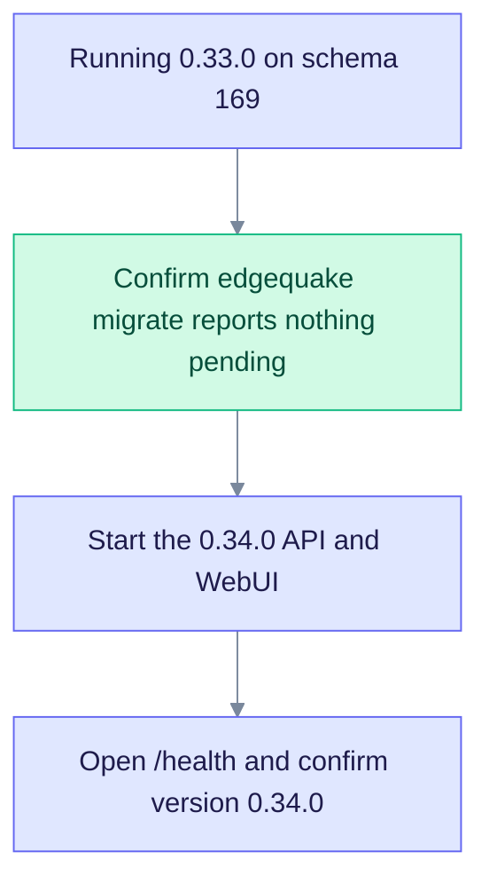

# Upgrade to EdgeQuake v0.34.0

> **From:** v0.33.0 · **To:** v0.34.0 · **Schema:** **169** (unchanged)

This release adds a picture tour of the website. Query, storage, and the database schema do not change. If you are already on **169**, `edgequake migrate` has nothing to apply. Roll the API and WebUI images.

**demo.edgequake.com:** this cut installs the 0.34.0 API and WebUI. Password auth remains the demo default. The screens in [the visual tour](../../tutorial/README.md) were taken on this demo before the cut. Those screens do not change in 0.34.0. The version in the corner of the pictures reads **0.33.0** because that is the build that was running when they were taken.

## Highlights

| Area | What changed |
|------|--------------|
| Docs | [tutorial/README.md](../../tutorial/README.md), linked from the README as "Click through the app" |
| Schema | Stays **169** |
| Migrate | No-op from 0.33.0 |
| Acc | Attested existing medical-mid pack (`valid: true`, 2026-08-15). Retrieval was not re-scored |

## Upgrade path

Read the chart from top to bottom. There is no new migration.

## Operator steps

1. You are on **v0.33.0** and schema **169**. If you are older, follow [upgrade-to-0.33.0.md](upgrade-to-0.33.0.md) first.
2. `edgequake migrate` against the existing database. It should report that **169** is already applied.
3. Deploy images `ghcr.io/raphaelmansuy/edgequake:0.34.0` and `ghcr.io/raphaelmansuy/edgequake-frontend:0.34.0`.
4. `GET /health` returns `"version": "0.34.0"`.

No new environment variables.
