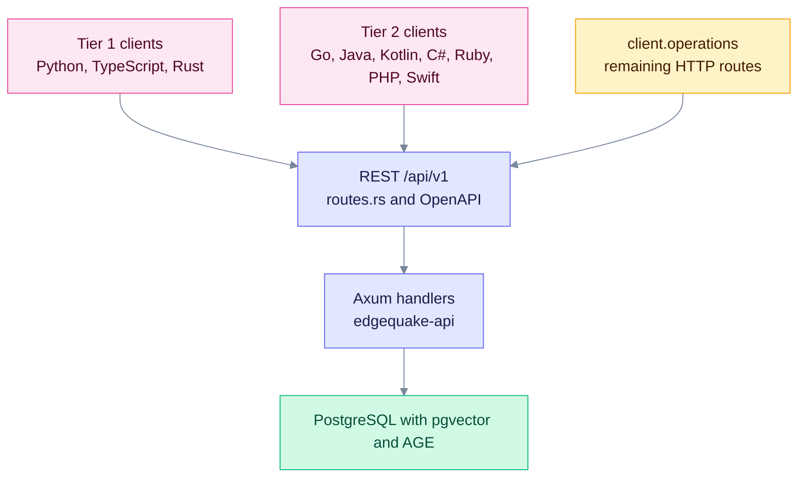

# Brutal honest SDK assessment

This page says what the SDKs cover today, including the gaps and the client bugs. It is for maintainers and integrators who need the truth, not a marketing summary. **Checked:** 2026-10-11 against EdgeQuake **v0.33.0**.

## Where the SDKs sit

Every SDK is a thin client over the same REST routes. Coverage gaps live in the clients, not in the server.

## Contract rules

- Paths and verbs must match `edgequake/crates/edgequake-api/src/routes.rs`. An invented URL is a client bug. `python3 sdks/tools/sdk_coverage.py --check --phantoms` fails when a hand-written call uses a path and verb the OpenAPI snapshot does not serve. User update is `PATCH /api/v1/users/{user_id}`.
- Request bodies must match the handler DTOs. The query endpoint reads `max_results` and `enable_rerank`.
- Pagination uses `page` and `page_size`. The server reads `page_size` on documents, entities, relationships and tasks.
- The OpenAPI snapshot still wins for optional fields on large structs. SDKs often trim models.

## Version decoupling

The Python, TypeScript, and Rust source is **0.4.1**. The other versioned SDKs are **0.4.0**. The product is **0.33.0**. PyPI and crates.io are **0.4.1**. npm is still **0.1.0**. Java, Kotlin, Go, C#, Ruby, PHP and Swift are not on public registries. See [VERSION-POLICY](VERSION-POLICY.md).

## Status by language

| Language | Source version | Registry (2026-10-10) | Wraps Connections | Known issues |
|----------|----------------|-----------------------|-------------------|--------------|
| Python | 0.4.1 | PyPI 0.4.1 | Yes | `top_k` and `rerank` are aliases of `max_results` and `enable_rerank`. `mode` is omitted unless set |
| TypeScript | 0.4.1 | npm 0.1.0 | Yes | Package name is `edgequake-sdk` |
| Rust | 0.4.1 | crates.io 0.4.1 | Yes | The `top_k` field serializes as `max_results`. `QueryMode` default is `Mix` |
| Go | no version field | Not on Go module proxy | Yes | The documented `go get` path does not resolve |
| Java | 0.4.0 | Not on Maven Central | Yes | `topK` serializes as `max_results`. Null fields are omitted |
| Kotlin | 0.4.0 | Not on Maven Central | Yes | Query `mode` is omitted unless set |
| C# | 0.4.0 | Not on NuGet | Yes | Query `mode` is omitted unless set |
| Ruby | 0.4.0 | Not on RubyGems | Yes | Query `mode` is omitted unless set. `top_k` is sent as `max_results` |
| PHP | no version field | Not on Packagist | Yes | Query `mode` is omitted unless set |
| Swift | no version field | SPM path only | Yes | Query `mode` is omitted unless set; declares macOS 13 only |

Tier 2 entries come from source reading. Live suites skip unless `EDGEQUAKE_E2E_URL` points at a healthy EdgeQuake API. C# reports those tests as Skipped. On 2026-10-11, `localhost:8080` served an EdgeIdentity page, and the shared scenario passed for all ten SDKs against the API on port 8091. `make sdk-e2e` exits 0 when the health check fails.

## Coverage by area

| Area | Tier 1 (Python, TypeScript, Rust) | Tier 2 |
|------|-----------------------------------|--------|
| Document list | Python and TypeScript send `page`, `page_size`, `date_from`, `date_to` and `document_pattern`. Rust has `list_with_query`. | Java, Kotlin, C#, Ruby, PHP, Swift, and Go send `page` and `page_size`. |
| Parse API (SPEC-094) | `parse()`, `backends()` and `job()` in all three | Not audited in this pass |
| Query body | Python, TypeScript, and Rust send `max_results` and `enable_rerank`. Python aliases `top_k` and `rerank` onto those keys. Rust serializes its `top_k` field as `max_results`. | Go and Java send `max_results`. Kotlin, C#, PHP, Swift, and Ruby omit `mode` unless the caller sets it. Chat still sends `top_k`. |
| Cancel and retry | `tasks` has cancel and retry in all three | Mostly listed, not audited |
| Presentation fields | `display_status` and `ui_phase` are on the typed document models in Python, TypeScript, Rust, Go, Java, Kotlin, and Swift | C# list items are `JsonElement` with `DisplayStatusAt` and `UiPhaseAt`. PHP and Ruby return decoded JSON |
| Connections and `providers/test` | Present on every SDK | Present |

## HTTP surface after generation

The checker found **228** OpenAPI operations: **226** HTTP and **2** WebSocket. After generation, every HTTP path string is present in every SDK. Counts are hand-written mentions, then generated methods. "Missing" means the path template is absent from that SDK's sources.

| Language | Hand-written | Generated | HTTP still missing |
|----------|-------------:|----------:|-------------------:|
| Python | 147 | 81 | 0 |
| TypeScript | 81 | 147 | 0 |
| Rust | 128 | 100 | 0 |
| Go | 68 | 160 | 0 |
| Java | 71 | 157 | 0 |
| Kotlin | 74 | 154 | 0 |
| C# | 73 | 155 | 0 |
| PHP | 71 | 157 | 0 |
| Ruby | 32 | 196 | 0 |
| Swift | 63 | 165 | 0 |

Each generated class has one `call` helper. Operation methods only build the path and delegate. Path segments are percent-encoded, and slashes inside a segment such as `mm-assets/{asset_path}` stay slashes. Query encoding, SSE parsing, and the WebSocket URL live in that helper. An empty query does not leave a trailing `?`. SSE methods return the `data:` lines, joined by newlines. WebSocket methods return a `ws://` or `wss://` URL. Prefer the hand-written resource when one exists.

## What is still open

| # | Where | What remains | Why it stays |
|---|-------|--------------|--------------|
| 1 | Go install | `github.com/edgequake/edgequake-go` is not on the module proxy. Install from this checkout. | Publishing the module is a separate release step |
| 2 | npm | `edgequake-sdk` on npm is still 0.1.0. Publish goes through `.github/workflows/sdk-publish.yml`. The stored npm token is not allowed to publish that package. | PyPI and crates.io are 0.4.1 |
| 3 | WebSocket | Generated methods return the socket URL. Python and TypeScript also have stream clients. The other languages do not open the socket | A full client would add a dependency in each language |
| 4 | SSE | Generated stream methods in every language return the same `data:` lines. Hand-written stream helpers still differ by language | There is no shared typed event model |
| 5 | Typed models | Large responses still drop optional OpenAPI fields | The contract fields used by callers are present: `max_results`, `page_size`, chat `top_k`, `display_status`, `ui_phase`, `llm_roles` |
| 6 | C# documents | List items stay `JsonElement`. `DisplayStatusAt` and `UiPhaseAt` read those keys. Detail responses have `DisplayStatus` and `UiPhase` | The list payload is not a fixed object |
| 7 | Live proof | On 2026-10-11, after the hand-written verb fixes, the shared scenario passed against `http://127.0.0.1:8091` (health JSON `status: healthy`, version 0.33.0) for all ten SDKs, one language at a time. It calls generated `GET /api/v1/setup/status` and checks the pipeline WebSocket URL. Java and Kotlin use a 30s HTTP timeout, so they fail if many SDKs query the LLM at once. Port 8080 on this machine is EdgeIdentity | `make sdk-e2e` exits 0 when that health check fails. The suite does not delete or wipe |
| 8 | MCP | `@edgequake/mcp-server` depends on `file:../sdks/typescript` | That pins the monorepo source, currently 0.4.1 |

PHP and Ruby document calls return decoded JSON, so `display_status` is a map key. PHPUnit does not load `tests/E2ETest.php`; run that file with `php` when the URL is set. Go e2e tests call `t.Skip` when `EDGEQUAKE_E2E_URL` is unset.

## Bottom line

- Every SDK sends query `max_results` or omits `mode` unless the caller sets it, lists with `page_size`, and wraps Connections plus `POST /api/v1/providers/test`. Chat still sends `top_k` when the caller sets it.
- `client.operations` covers the remaining HTTP routes. Method names come from OpenAPI `operationId`. Hand-written methods that called a missing path were removed; a wrong verb was changed to the handler verb.
- Install from the monorepo when you need those methods. Use a registry pin only when the table says the package is published.
- Track coverage in [SDK-API-COVERAGE](../../specs/009-skd-update/SDK-API-COVERAGE.md). Regenerate with `python3 sdks/tools/sdk_coverage.py --generate`.
