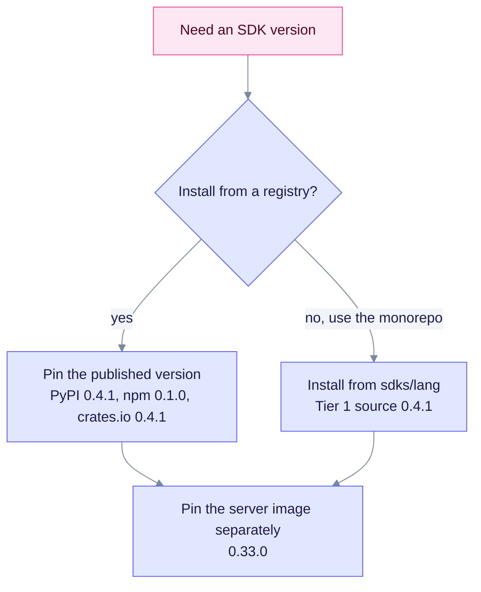

# SDK version policy

The server is at **0.33.0**. Client libraries use their own semver (X-33: this is not the product line, including the older 0.20.x product numbers). Python, TypeScript, and Rust source are **0.4.1**. The other versioned SDKs in this repo are **0.4.0**. This page explains why, and how to choose a pin. It is for release managers and integrators.

## Two version lines

| Surface | Version (2026-10-11) | Meaning |
|---------|----------------------|---------|
| Server, Docker image and workspace crates | **0.33.0** | Product release. Image: `ghcr.io/raphaelmansuy/edgequake:0.33.0` |
| Python, TypeScript, and Rust under `sdks/` | **0.4.1** | Client library semver. Includes Connections and the query wire fields `max_results` / `enable_rerank`. |
| Other versioned SDK source trees | **0.4.0** (Go, PHP and Swift have no version field) | Client library semver. Source wraps Connections; these trees were not republished. |
| Published registries | npm still lags the source | PyPI `edgequake-sdk` **0.4.1**, crates.io `edgequake-sdk` **0.4.1**, npm `edgequake-sdk` **0.1.0**. The other SDKs are not published. |

A 0.4.x client talking to a 0.33.x server is intentional when the OpenAPI paths match. SDK majors bump when the client API breaks, not on every server patch.

## Rules

1. The contract source of truth is the server OpenAPI, generated from `routes.rs`. Refresh it with `make codegen-openapi-refresh`.
2. SDK package versions track client surface changes, not every server patch.
3. When an SDK breaking change ships, bump the SDK major and state the minimum server version in that SDK's README.
4. Root GitHub Actions workflows (`.github/workflows/sdk-*.yml`) run SDK CI and publish. Nested `sdks/*/.github/workflows` files are not run by GitHub Actions. Test with `.github/workflows/sdk-ci.yml`. Publish Python, TypeScript, and Rust with `.github/workflows/sdk-publish.yml`.
5. Every SDK in this repo wraps the v0.33.0 Connections routes and `POST /api/v1/providers/test`. Python, TypeScript, and Rust are versioned 0.4.1. The other clients still report 0.4.0, or have no version field.

## Choose a pin

Pick the SDK pin from where you install it. Pin the server image on its own line, because the server moves on the product version.

| Goal | Pin |
|------|-----|
| Match published PyPI | `pip install edgequake-sdk==0.4.1` |
| Match published npm | `npm install edgequake-sdk@0.1.0` |
| Match published crates.io | `edgequake-sdk = "0.4"` in `Cargo.toml` |
| Match monorepo Tier 1 | Install from `sdks/python`, `sdks/typescript`, or `sdks/rust` (source 0.4.1) |
| Match another monorepo SDK | Install from `sdks/<lang>` (source 0.4.0 where a version field exists) |
| Match a server image | Pin the server tag `0.33.0` separately from the SDK |

Related: [SDK overview](README.md), [Brutal assessment](BRUTAL-ASSESSMENT.md).
