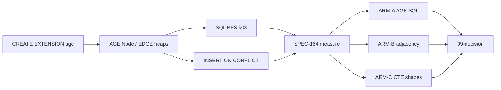

# SPEC-164 — Pure PostgreSQL Graph Study

> **Status:** **Complete** — decision **migrate feasible** ([09-decision.md](09-decision.md)). Scratch schema only; no production migration.  
> **Question:** Is Apache AGE still necessary for EdgeQuake, given that the request path already uses native SQL against AGE heaps?  
> **Answer:** Not for complexity or measured latency at ≤1M nodes under product hop caps. AGE remains a hosting/ops cost until an implementation spec cutover.  
> **Proof:** `make -C specs/164-pure-postgres-study proof` → [`measurements/results.json`](measurements/results.json) + [`reports/PROOF.md`](reports/PROOF.md) (run 2026-10-11).

## One-screen answer shape

```text
  Product hops: depth ≤ 3, neighbors ≤ 500, BFS batched SQL
  ─────────────────────────────────────────────────────────
  Arm A: AGE child tables + native SQL (current)
  Arm B: plain nodes/edges + btree (candidate)
  Arm C: same B tables + level-set CTE / UNION ALL control
  ─────────────────────────────────────────────────────────
  Decision rule: migrate feasible if B ≤ 2× A on every
  request-path op at 200k nodes AND neighbor sets match
```



## Inherits (do not re-derive)

| Spec | What we inherit | What we reopen |
|------|-----------------|----------------|
| [SPEC-021](../021-storage-study/) | Dual-store / CQRS context | Pure-relational rejection (no measurement) |
| [SPEC-034](../034-graph-storage-improvement/) | 69× Cypher GIN vs btree **inside AGE**; native writes shipped | Replacing AGE itself |
| [SPEC-091 LD-04](../091-simplify-data-layer/) | AGE named traversal authority | Authority may move if proof kills LD-04 |
| [SPEC-148 LAW-148-1](../148-gcloud-hosting/) | Cloud SQL / AlloyDB lack `age` | Whether that gate can flip via plain SQL |
| [SPEC-149 D4](../149-data-access-improvements/) | Relational projection ≠ traversal | Same |

## Success criteria

| ID | Criterion | Evidence |
|----|-----------|----------|
| S1 | Five-why chains written with mermaid | [00-five-whys.md](00-five-whys.md) |
| S2 | Laws + cross-ref matrix with stable ids | [01](01-first-principles.md) · [04](04-cross-ref-matrix.md) |
| S3 | Full `GraphStorage` contract → plain-SQL map | [03-current-graph-contract.md](03-current-graph-contract.md) |
| S4 | Protocol and hypotheses registered **before** timings | [06-experiment-protocol.md](06-experiment-protocol.md) |
| S5 | Scales S + M + Hub measured; L only if M fits budget | [measurements/results.json](measurements/results.json) |
| S6 | Neighbor-set equality for 50 random starts (A/B/level-CTE) | `correctness` in results |
| S7 | Decision cites measured numbers only | [09-decision.md](09-decision.md) · [reports/PROOF.md](reports/PROOF.md) |
| S8 | Production Q-GRAPH inventory + gap ops 09..14 measured | [10](10-query-inventory.md) · [11](11-coverage-gap-analysis.md) · [inventory_results.json](measurements/inventory_results.json) |

## Reading order

1. [00-five-whys.md](00-five-whys.md) — why this study exists  
2. [01-first-principles.md](01-first-principles.md) — LAW-164-*  
3. [02-prior-decisions.md](02-prior-decisions.md) — dated numbers from 034/091/148  
4. [03-current-graph-contract.md](03-current-graph-contract.md) — trait contract  
5. [10-query-inventory.md](10-query-inventory.md) — **every production Q-GRAPH-* shape**  
6. [11-coverage-gap-analysis.md](11-coverage-gap-analysis.md) — OP coverage vs inventory  
7. [04-cross-ref-matrix.md](04-cross-ref-matrix.md) — SSOT ids  
8. [05-complexity-proof.md](05-complexity-proof.md) — O(·) analysis  
9. [06-experiment-protocol.md](06-experiment-protocol.md) — harness contract  
10. [07-target-relational-model.md](07-target-relational-model.md) — candidate DDL  
11. [08-migration-feasibility.md](08-migration-feasibility.md) — file map (study only)  
12. [12-v035-migration-plan.md](12-v035-migration-plan.md) — **next-release plan, code-grounded, edge cases**  
13. [09-decision.md](09-decision.md) — keep / migrate / migrate-reads  
14. [reports/PROOF.md](reports/PROOF.md) — honest bounds  

Proof commands:

```bash
./measurements/run_bench.sh              # OP-164-01..08 + CTE
./measurements/run_inventory_bench.sh    # OP-164-09..14 from inventory gaps
```


## Non-goals

- Changing `PostgresAGEGraphStorage`, production migrations, or Docker images in this spec.
- Treating PostgreSQL 19 SQL/PGQ as an available engine (product pin is PG18).
- Re-benchmarking HNSW, KV GIN, or LLM extraction.
- Claiming wall-clock ingest improvement without measuring it (SPEC-034 gap).

## Proof command

```bash
# Requires EdgeQuake Postgres (AGE + pgvector). Default: docker container eqdoc-scratch.
export SPEC164_PG_CONTAINER="${SPEC164_PG_CONTAINER:-eqdoc-scratch}"
export SPEC164_PG_USER="${SPEC164_PG_USER:-edgequake}"
export SPEC164_PG_DB="${SPEC164_PG_DB:-edgequake}"
./specs/164-pure-postgres-study/measurements/run_bench.sh
```

Artifacts land in `measurements/results.json`, `measurements/explains/`, and `reports/PROOF.md` is updated from that file.
