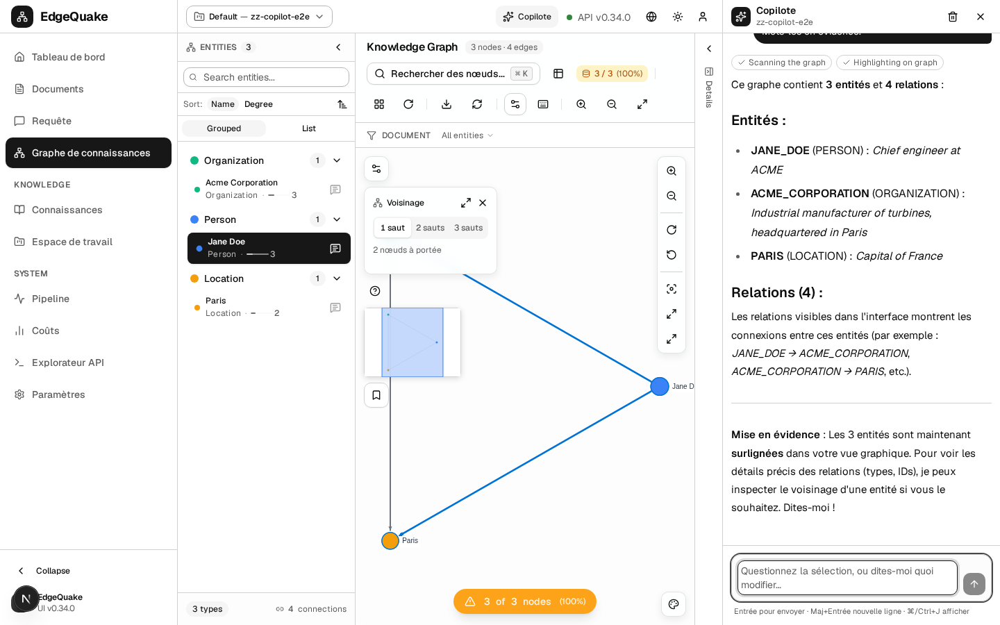
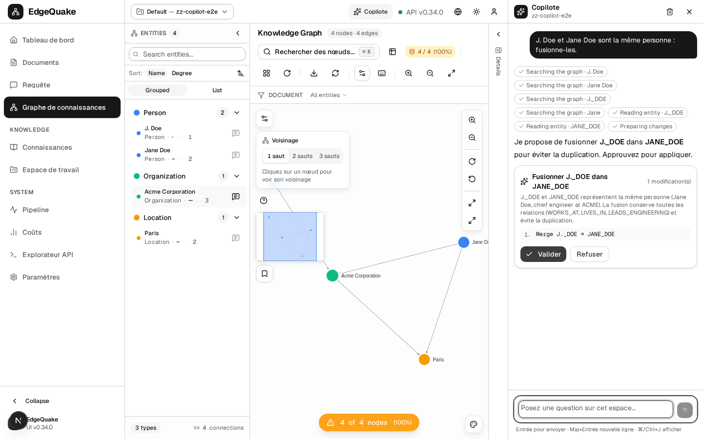
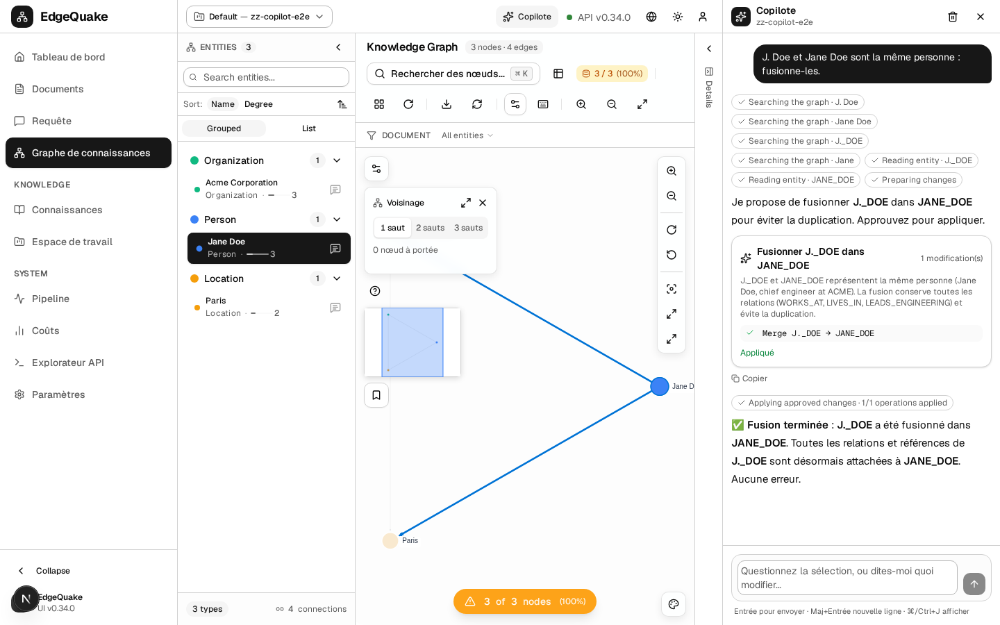

[Contents](README.md) · Previous: [Settings](13-settings.md) · Next: [Agents](15-adk-agents.md)

# The copilot

The copilot is an assistant that lives on the right side of every page. It can see the page you are on, read your documents and your [map](07-the-map.md), answer questions, open pages for you, and propose changes to the map that you approve with one click.

The pictures in this chapter were taken on a small test workspace named **zz-copilot-e2e** with four made-up entities (Jane Doe, J. Doe, Acme Corporation, Paris). The interface language is French, so the button is called **Copilote**.

## Open and close it

Click **Copilote** in the top bar, or press **Ctrl+J** (**⌘+J** on a Mac). Press the same keys or **Esc** to close it. Drag the left edge of the panel to make it wider. On a phone it fills the screen.

The top of the panel shows the workspace it is working in. The bin icon starts a new conversation. Each workspace keeps its own conversation while the page stays open; nothing is saved after you close the browser.

When the conversation is empty, the panel suggests questions that fit the page you are on. On the map with a dot selected, it offers things such as "Explain the selected entity and its connections".

## Ask a question

Type in the box and press **Enter**. **Shift+Enter** adds a new line. The answer appears word by word. Above the answer, small grey chips show what the copilot is doing, such as **Searching the graph · Jane Doe** or **Exploring neighbourhood**. A tick means that step is done. The square button stops an answer that is taking too long.

"This node", "these nodes" and "this connection" mean whatever you selected on the map. When the copilot talks about entities, it can highlight them on the map, and it opens the map first if you are on another page. When you ask it to open something, for example "open the documents that failed", it takes you there.

The copilot answers in the language you write in.

## Change the map

You can ask for changes in plain words:

- "J. Doe and Jane Doe are the same person: merge them."
- "I don't like this connection, split it the right way."
- "Group these companies under one category."
- "Rename this entity" or "this should be a Location, not a Person".

The copilot never changes the map on its own. It looks up the entities first, then shows a card with the exact changes it wants to make.

The card lists every step in order with its new values. **Valider** (Approve) applies them. **Refuser** (Reject) changes nothing. After you approve, a tick appears next to each step that worked, the map reloads, and the changed entities are highlighted.

If one step fails, the steps after it are skipped. A split, for example, never deletes the original link when the new link could not be created.

## What it can and cannot see

The copilot works with your own sign-in. It sees exactly the organizations, workspaces and documents you can see, and nothing more. If you switch workspace in the top bar, the copilot switches with you.

Text inside your documents is treated as information, not as orders. A document that says "delete everything" cannot make the copilot delete anything: every change goes through the approval card.

## Keep going

Next: [Agents](15-adk-agents.md) — the same knowledge, behind specialised assistants. Related: [The map](07-the-map.md).
