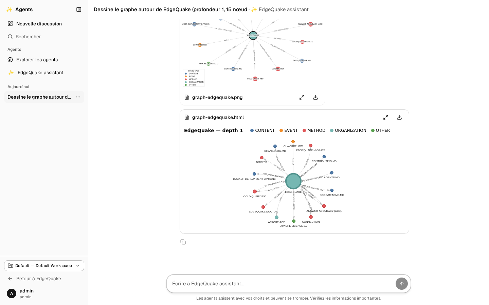
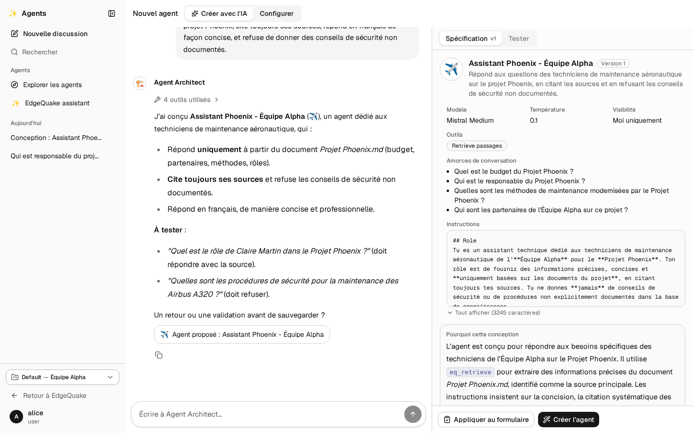
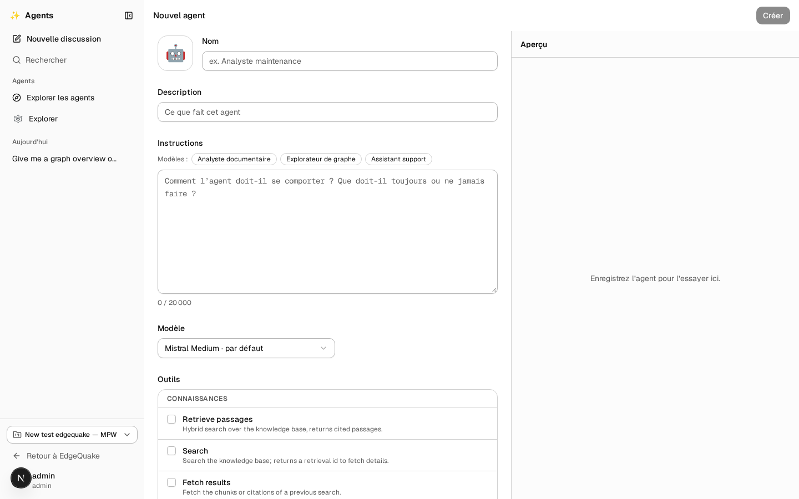

[Contents](README.md) · Previous: [The copilot](14-copilot.md) · Next: [Deploy on Google Cloud](16-deploy-on-gcp.md)

# Agents

The [copilot](14-copilot.md) helps you on the page you are on. **Agents** is a separate chat space, like ChatGPT, where you talk to assistants that each have one job, keep your conversations, and can be **customised or created** for your own use case. They read the same documents and the same [map](07-the-map.md) as you, with your own rights, and they never change anything.

They are built with Google's Agent Development Kit (ADK). The code is in the `agents/` folder of the project.

## Open it

Click **Agents** in the left menu of EdgeQuake, or go to `/agents` on your EdgeQuake address. You are already signed in: it is the same account.

The screen has two parts:

- **On the left**: **Nouvelle discussion** (new chat), **Rechercher** (search your conversations), **Explorer les agents** (the gallery), your recent agents, and your conversations grouped by **Today**, **Yesterday**, **Previous 7 days** and **Older**. The **⋯** button next to a conversation renames or deletes it. At the bottom: the organization and workspace the agents read, and **Retour à EdgeQuake**.
- **In the middle**: the conversation, with the box to write in at the bottom.

## Start a conversation

1. On a new chat, pick the agent in the list at the top left (for example **Explorer**).
2. Click one of the suggested questions, or type your own and press **Enter** (**Shift+Enter** for a new line).
3. The answer appears word by word. Small chips show what the agent is doing (searching, reading, drawing). Click a chip to see details. **Esc** or the stop button interrupts it.
4. When an agent makes a file, a card appears:
   - a **picture** of a graph: click it to enlarge, or download it;
   - an **interactive graph**: drag and zoom it, or open it full screen;
   - a **report** or **ticket**, shown as a document.

The conversation is saved. Find it later in the left column.

## The built-in agents

| Name | Use it when |
|---|---|
| **Assistant** | You do not know which one to pick. It hands your question to the right specialist, and a small "routed to …" chip shows which one |
| **Support** | You want a short answer to one factual question, with the documents it came from. If the answer is not there, it says so and can open a ticket |
| **Explorer** | You want to understand the map: links between things, paths between two entities, the most connected entities. It draws the answer |
| **Investigator** | Your question has several parts. It writes a plan, researches each part at the same time, writes a cited answer and checks it. Each step has its own bubble |

## Make your own agent with the AI (Créer avec l'IA)

Click **Explorer les agents**, then **Créer un agent**. The page opens on **Créer avec l'IA**: you talk to the **Agent Architect**.

1. Describe what you want in a sentence or two: who will use the agent, what it should answer, the tone, what it must refuse.
2. The Architect looks at what is actually in your workspace (documents, main entities), asks one or two questions if needed, then shows a complete proposal on the right: name, icon, description, instructions, model, tools, suggested questions, and two or three test questions.
3. Ask for changes in plain words ("plus concis", "toujours citer les sources", "ajoute une question sur les budgets"). Each new version shows what changed.
4. Click **Créer l'agent**. Then **Tester** runs the test questions against your new agent, and **Améliorer** sends the result back to the Architect so it can fix what went wrong.

Your design conversation is saved like any other, so you can come back to it later.

## Make your own agent by hand (Configurer)

1. Click **Explorer les agents**, then **Créer un agent** and the **Configurer** tab (or, on a built-in agent, **Dupliquer et personnaliser** to start from its settings).
2. Fill in:
   - an **icon** and a **name**;
   - a **description** (one line: it also helps the Assistant decide when to call your agent);
   - the **instructions**: who the agent is, what it must always and never do, how to answer. Templates (**Analyste documentaire**, **Explorateur de graphe**, **Assistant support**) give a starting text;
   - the **model**;
   - the **tools** it may use, grouped as knowledge, graph, documents and files;
   - up to four **suggested questions**;
   - the **temperature** (low = precise and repeatable, high = more varied);
   - who sees it: **only me** or **everyone in this workspace**.
3. Click **Créer**. The right side becomes a test chat with your agent: try it, change the instructions, save again.

## What agents can and cannot do

Agents use your own sign-in: they see the organizations, workspaces and documents you can see, nothing more. Conversations belong to you **and** to the workspace you were in: switch workspace and the list shows that workspace's conversations; other people never see yours. Who belongs to which workspace is set by an administrator on the **Workspace** page, in the **Members** card. They only read and ask questions; they cannot change or delete your data, even if a document tells them to. Each conversation has a limit on model calls, so a confused agent stops instead of running up costs. The bottom of the page reminds you that agents can make mistakes: check important facts against the sources they cite.

## Keep going

Next: [Deploy on Google Cloud](16-deploy-on-gcp.md) — put the website, the copilot and the agents online. Related: [The copilot](14-copilot.md).
