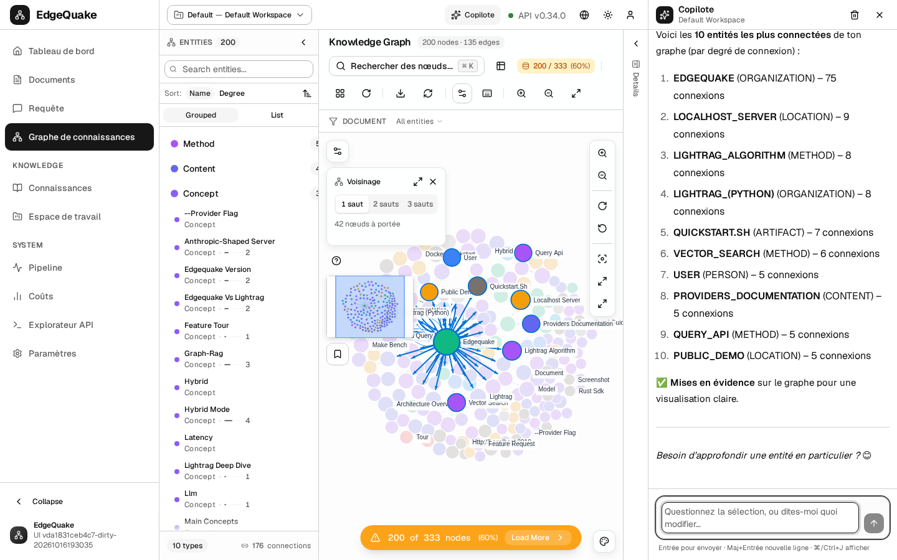

[Contents](README.md) · Previous: [Agents](15-adk-agents.md) · Next: [What this is](01-what-this-is.md)

# Deploy on Google Cloud

This chapter puts the whole product online on your own Google Cloud project: the website, the [copilot](14-copilot.md) and the [agents](15-adk-agents.md). One command builds it and starts it. Another command removes it.

You need a terminal on your computer. Everything below is typed in the folder of the project.

## What you need first

- A Google Cloud **project** with **billing** turned on.
- Your Google account must be **Owner** of that project (or Editor plus Security Admin plus Service Usage Admin).
- The `gcloud` and `terraform` programs installed.
- At least one working model key in the `.env` file at the top of the project, for example `MISTRAL_API_KEY=...`. Check it works before you start:

```bash
curl -s -o /dev/null -w '%{http_code}\n' https://api.mistral.ai/v1/models -H "Authorization: Bearer $MISTRAL_API_KEY"
```

`200` means the key works.

Sign in once:

```bash
gcloud auth login
gcloud projects list        # your project must be in this list
```

Terraform also uses your Google sign-in, through a second login:

```bash
gcloud auth application-default login
```

## Put it online

Copy the settings file and fill in your project and key:

```bash
cd deploy/gcp/terraform
cp terraform.tfvars.example terraform.tfvars
# edit terraform.tfvars: project_id = "YOUR_PROJECT_ID" and mistral_api_key = "..."
terraform init
terraform apply
```

Type **yes** when Terraform asks. That single `apply` builds the images from your copy of the code, creates the machine and everything around it, starts the services, and only finishes when the site answers. Then:

```bash
terraform output public_origin
terraform output agents_url
$(terraform output -raw admin_password_command)
```

If you prefer one command with extra checks, `deploy/gcp/up.sh --project YOUR_PROJECT_ID` runs the same Terraform for you. It:

1. checks you can use the project;
2. reads the model keys from `.env` without printing them;
3. shows what it will create and asks you to type **yes**;
4. builds the website, the server and the agents from **your** copy of the code (in Google Cloud Build);
5. creates the machine and starts everything;
6. waits until the site answers, then prints its address.

The first run takes a while: building the server is the slow part. When it ends you see something like:

```
EdgeQuake: https://34-12-56-78.sslip.io
Admin user: admin
Admin password: gcloud secrets versions access latest --secret=edgequake-bootstrap-admin-password --project=YOUR_PROJECT_ID

Agents:     https://34-12-56-78.sslip.io/agents   (same sign-in)
```

The password is never printed. Run the `gcloud secrets ...` line to see it.

The address ends in **sslip.io**: that is a free name that points at your machine's address, so the site gets a real padlock (HTTPS) without buying a domain. To use your own domain, add `TF_VAR_hostname=edgequake.example.com` in front of the command and point the domain at the address shown by `terraform -chdir=deploy/gcp/terraform output -raw external_ip`.

Useful settings in `terraform.tfvars`:

| Setting | Effect |
|---|---|
| `build_mode = "local"` | Build on your computer instead of Cloud Build (faster on a strong machine; needs Docker and about 30 GB of free disk) |
| `image_tag = "X"` with `build_images = false` | Do not build; run images already pushed with tag X (roll back) |
| `machine_type = "e2-medium"` | Cheaper machine |
| `hostname = "edgequake.example.com"` | Your own domain instead of sslip.io |

## Sign in and try it

1. Open the EdgeQuake address. Sign in as **admin** with the first password.
2. Go to [Documents](04-documents.md) and add a file. Wait until it says it is finished in the [Pipeline](10-pipeline.md).
3. Open the [map](07-the-map.md), then press **Ctrl+J** and ask the copilot about it.
4. Click **Agents** in the left menu (or open `/agents`), choose **Explorer**, and ask it to draw an entity. It uses the same sign-in.



## What it creates, and what it costs

| Part | Why |
|---|---|
| One virtual machine (`e2-standard-2`) | Runs the database, the server, the website, the agents and the web front door (Caddy) |
| A separate data disk with a copy every night (kept 14 days) | Your data survives a broken machine |
| A fixed internet address | The address does not change after a restart |
| An image store (Artifact Registry) | Holds the pictures of your build |
| Secret Manager | Holds every password and key; nothing secret is in the code |
| A firewall | Only the web ports are open; administrator access goes through Google's identity-checked tunnel |

Around **65–70 US dollars a month** in Europe for the machine, disk and address, plus a few dollars for each build. Use `TF_VAR_machine_type=e2-medium` for about 40 dollars, at the cost of speed when reading many documents.

## Update after a code change

Run `terraform apply` again in `deploy/gcp/terraform`. Terraform notices the code changed, builds new images, and restarts the services on the same machine. If nothing changed, it does nothing. Your documents and map stay on the data disk.

## Look inside the machine

```bash
terraform -chdir=deploy/gcp/terraform output -raw ssh_iap_command   # prints the ssh command
# then, on the machine:
sudo docker ps
sudo tail -f /var/log/edgequake-startup.log
```

## Take it down

```bash
cd deploy/gcp/terraform
terraform destroy
```

Type **yes**. It removes everything it created, including the data disk and the images. The nightly copies of the data disk are removed too if `keep_snapshots_on_destroy = false` is in `terraform.tfvars` (and you ran `terraform apply` after setting it). With `true`, they are kept on purpose; delete them later under **Compute Engine → Snapshots**.

`deploy/gcp/down.sh` does the same and asks you to type the project id first.

## When something goes wrong

| Message | What to do |
|---|---|
| `does not have permission to access projects instance` | You are signed in with an account that is not Owner of that project. Check `gcloud auth list` and `gcloud projects list` |
| `due to quota restrictions, Cloud Build cannot run builds of this machine type` | New projects cannot use big build machines. The script already falls back to smaller ones; or use `--build local` |
| The site shows no padlock for the first minutes | The certificate is being issued. Wait a few minutes and reload |
| Questions and uploads fail | The model key is wrong or missing. Fix `.env` and run `up.sh` again |

## Keep going

You have the whole product online. [What this is](01-what-this-is.md) starts the tour again; the technical record of this setup is in [specs/164-copilot-auth-gcp-agents](../specs/164-copilot-auth-gcp-agents/README.md).
