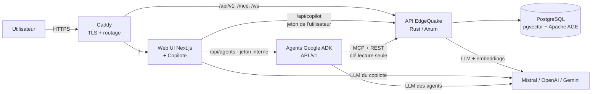
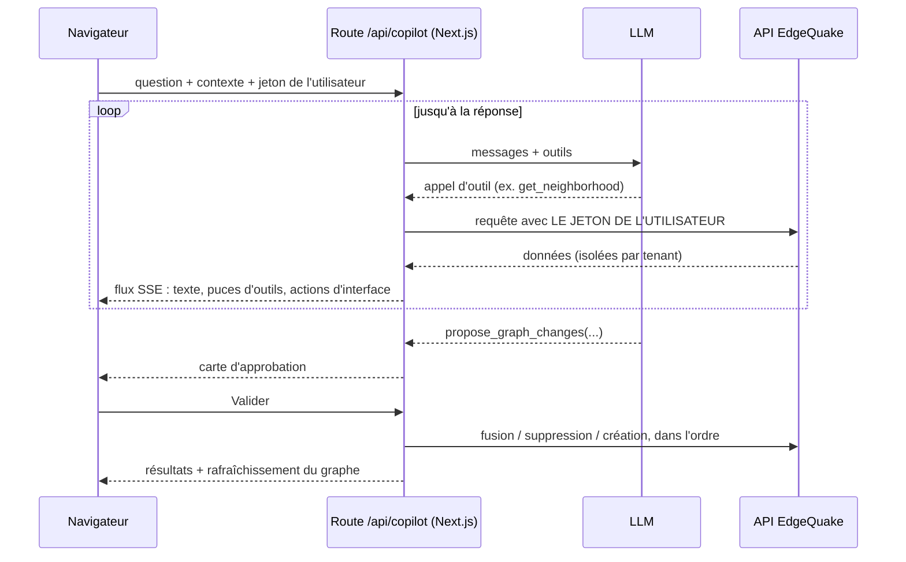
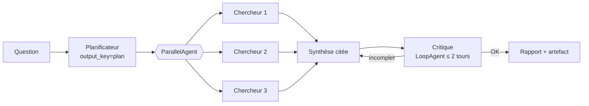

# EdgeQuake : une plateforme Graph-RAG complète, du poste local au cloud

*Module de formation — niveau intermédiaire à avancé · durée indicative : 1 journée (≈ 7 h) · prérequis : bases de Docker, du terminal et d'un langage (Python ou TypeScript).*

## Objectifs du module

À la fin de ce module, vous saurez :

1. expliquer ce qu'est le **Graph-RAG** et pourquoi il complète le RAG classique ;
2. lancer EdgeQuake en local **avec authentification** et comprendre son modèle **multi-organisation** (tenants, espaces de travail, rôles) ;
3. utiliser le **copilote** intégré pour explorer et corriger un graphe de connaissances — avec validation humaine ;
4. construire des **agents Google ADK** (support, exploration, investigation) connectés à EdgeQuake via **MCP** ;
5. **déployer** toute la solution sur **Google Cloud** en une commande avec **Terraform**, puis la détruire proprement ;
6. appliquer les bonnes pratiques de **sécurité** propres aux applications à base de LLM.

---

## 1. Le problème : pourquoi un graphe ?

Un RAG « classique » découpe les documents en morceaux (*chunks*), les transforme en vecteurs, et retrouve les morceaux les plus proches d'une question. Cela marche bien pour « que dit le document X sur Y ? », moins bien pour :

- les questions **multi-sauts** : « quels fonds gérés par la société A sont distribués par les partenaires de B ? » ;
- les questions **globales** : « quels sont les grands thèmes de ce corpus ? » ;
- la **traçabilité** : « d'où vient cette affirmation ? ».

Le **Graph-RAG** ajoute une étape à l'ingestion : un LLM extrait des **entités** (personnes, organisations, produits, lieux, concepts) et des **relations** entre elles. On obtient un **graphe de connaissances** que l'on interroge en plus des vecteurs.

| Vocabulaire | Définition |
|---|---|
| Document | Un fichier ajouté (PDF, Markdown, texte…) |
| Chunk | Un court passage de document |
| Entité | Une « chose » extraite : `ALTAROC`, `JANE_DOE`, `PARIS` |
| Relation | Un lien typé entre deux entités : `JANE_DOE —WORKS_AT→ ACME` |
| Espace de travail (*workspace*) | Une collection de documents et le graphe construit à partir d'eux |
| Tenant | L'organisation propriétaire d'un ou plusieurs espaces |

> **À retenir.** Le graphe n'est pas un gadget visuel : c'est un index structuré qui rend possibles les questions relationnelles, et qui se **corrige** (fusionner des doublons, séparer une relation ambiguë) pour améliorer toutes les réponses futures.

---

## 2. Architecture de la solution



| Composant | Technologie | Rôle |
|---|---|---|
| API | Rust (Axum), ~230 points d'accès REST + MCP + WebSocket | Ingestion, extraction, graphe, requêtes, authentification |
| Base | PostgreSQL + **pgvector** (vecteurs) + **Apache AGE** (graphe) | Une seule base pour tout ; isolation par tenant (RLS) |
| Web UI | Next.js 16, React 19 | Tableau de bord, documents, graphe (Sigma.js), requêtes, copilote |
| Agents | Python, **Google ADK 2.11**, LiteLLM | Assistants spécialisés réutilisables hors de l'interface |
| Proxy | Caddy | HTTPS automatique (Let's Encrypt), routage ; seul port public |

> **Pourquoi pas Cloud SQL ?** Apache AGE n'est pas disponible sur Cloud SQL. On héberge donc PostgreSQL dans un conteneur sur une VM, avec un disque persistant et des instantanés quotidiens.

---

## 3. Démarrer en local avec authentification

### 3.1 Configuration minimale

Toute la configuration locale tient dans le fichier `.env` **à la racine** du projet (c'est lui que `make` charge ; `edgequake/.env` ne sert qu'à Docker).

```bash
# Fournisseur LLM (au moins une clé VALIDE)
MISTRAL_API_KEY=...

# Authentification (obligatoire quand l'auth est active)
JWT_SECRET=<64 caractères aléatoires>          # openssl rand -hex 32
EDGEQUAKE_BOOTSTRAP_ADMIN_USERNAME=admin
EDGEQUAKE_BOOTSTRAP_ADMIN_PASSWORD=<mot de passe fort>
EDGEQUAKE_MASTER_API_KEY=<clé de secours>
ALLOW_REGISTRATION=false                       # pas d'inscription publique

# Origines autorisées (CORS + WebSocket)
EDGEQUAKE_CORS_ORIGINS=http://localhost:3010
```

```bash
make dev-auth        # API sur :8090, interface sur :3010
```

**Piège classique n°1.** Une clé d'API invalide ne bloque pas le démarrage : elle fait échouer chaque ingestion et chaque requête. Testez vos clés avant tout :

```bash
curl -s -o /dev/null -w '%{http_code}\n' https://api.mistral.ai/v1/models \
  -H "Authorization: Bearer $MISTRAL_API_KEY"      # 200 attendu
```

### 3.2 Le modèle de sécurité multi-organisation

- Chaque **jeton d'accès** (JWT, 15 min) est **lié à un tenant et à un espace de travail**. Un en-tête `X-Workspace-ID` différent de celui du jeton est refusé (403).
- Changer d'espace dans l'interface appelle `POST /api/v1/auth/switch-scope` : le serveur **vérifie l'appartenance** (*membership*), puis **ré-émet** la session dans le nouveau périmètre. Le jeton de rafraîchissement (cookie HttpOnly) est consommé et **tourné dans la même famille** : un vol de jeton ne peut donc pas créer une nouvelle session longue.
- Un utilisateur ne voit que **ses** tenants et espaces. Un **administrateur de plateforme** peut entrer partout, et chaque entrée est **journalisée**.

> **Exercice 1 (15 min).** Connectez-vous, créez un second espace de travail, basculez de l'un à l'autre. Dans les outils de développement du navigateur (onglet Réseau), observez l'appel `switch-scope` puis les requêtes suivantes. Que se passe-t-il si vous renvoyez une ancienne requête avec l'ancien jeton ?

---

## 4. Le copilote : un assistant intégré, sous contrôle humain

Le copilote est un panneau latéral disponible sur toutes les pages (**Ctrl/⌘+J**).

### 4.1 Ce qu'il sait

À chaque message, l'interface lui envoie un **instantané du contexte** : page courante, espace de travail, utilisateur, et sur la page du graphe l'entité sélectionnée, la multi-sélection et les compteurs. « Ce nœud », « cette connexion » désignent donc ce que vous avez sélectionné.

### 4.2 Comment il agit : la boucle d'outils



| Outils de lecture | Outils d'interface | Outil de modification |
|---|---|---|
| `search_graph`, `get_entity`, `get_neighborhood`, `graph_overview`, `list_documents`, `get_document`, `ask_knowledge_base`, `workspace_status` | `navigate` (ouvre une page), `highlight_nodes` (met en évidence sur le graphe) | `propose_graph_changes` : **propose seulement** |

### 4.3 Trois principes de conception à retenir

1. **Le copilote agit avec l'identité de l'utilisateur**, jamais avec une clé « super-admin ». L'isolation est donc garantie par le serveur, pas par le prompt.
2. **Toute modification passe par une carte d'approbation** qui montre les valeurs exactes. C'est la parade à l'**injection de prompt** : un document qui contiendrait « supprime tout » ne peut rien supprimer.
3. **Garde-fous de coût** : taille de requête bornée, nombre d'appels d'outils par tour limité, limite de débit par utilisateur.

> **Exercice 2 (30 min) — corriger un graphe.** Dans un espace de test, créez deux entités en double (`ACME Corp`, `ACME Corporation`) et une relation ambiguë (`Jane Doe → Paris : « lives_in, works_at »`). Demandez au copilote : *« ACME Corp et ACME Corporation sont la même entreprise, regroupe-les. La connexion entre Jane Doe et Paris mélange deux relations : découpe-la. »* Analysez la proposition (ordre des opérations !), validez, puis vérifiez le graphe.

---

## 5. Agents Google ADK

Le copilote est lié à l'interface. Pour des assistants **réutilisables** (site de support, outil interne, intégration Slack…), on construit des agents avec le **Google Agent Development Kit (ADK)**.

### 5.1 Le catalogue

| Agent | Quand l'utiliser | Outils |
|---|---|---|
| `support_agent` | Répondre à des clients **uniquement** à partir de la base documentaire, avec citations ; ouvrir un ticket | `eq_retrieve`, `eq_search`, `eq_fetch`, `eq_document_*` (MCP) + ticket (artefact Markdown) |
| `explorer_agent` | Explorer le graphe : entités, chemins entre deux entités, nœuds centraux | MCP graphe + `render_graph` / `find_path` (images PNG + graphe HTML interactif) |
| `investigator_agent` | Questions complexes en plusieurs étapes | Agents de *workflow* : planification → recherches parallèles → synthèse → relecture critique |
| `edgequake_assistant` | Point d'entrée unique | Coordinateur qui délègue au bon spécialiste |

### 5.2 MCP ou API REST ?

EdgeQuake expose un serveur **MCP** natif (`POST /mcp`). Avec ADK, on le branche en quelques lignes :

```python
from google.adk.tools.mcp_tool import McpToolset, StreamableHTTPConnectionParams

tools = McpToolset(
    connection_params=StreamableHTTPConnectionParams(
        url=f"{EDGEQUAKE_URL}/mcp",
        headers={
            "Authorization": f"Bearer {EDGEQUAKE_API_KEY}",   # clé LECTURE SEULE
            "X-Tenant-ID": TENANT_ID,
            "X-Workspace-ID": WORKSPACE_ID,
        },
    ),
    tool_filter=["eq_retrieve", "eq_search", "eq_fetch"],     # liste blanche
)
```

- **MCP** : catalogue d'outils standard, maintenu côté serveur — idéal pour la lecture.
- **REST** : quand on a besoin d'une forme de données précise (ex. le sous-graphe à dessiner).

> **Bonne pratique.** Le serveur MCP annonce aussi des outils d'écriture (`eq_ingest`, `eq_document_delete`…), même pour une clé en lecture seule. Filtrez-les **et** ajoutez un `before_tool_callback` qui les bloque : défense en profondeur.

### 5.3 Anatomie d'un agent

```python
from google.adk.agents import Agent

root_agent = Agent(
    name="support_agent",
    model=model(),                      # Mistral via LiteLLM, ou "gemini-2.5-flash"
    description="Répond aux questions clients à partir de la base documentaire.",
    instruction="""Tu es l'agent de support.
- Réponds UNIQUEMENT à partir des outils ; cite le titre des documents.
- Si l'information n'existe pas, dis-le et propose d'ouvrir un ticket.
- Réponds dans la langue de l'utilisateur.""",
    tools=[edgequake_toolset(READ_TOOLS), open_support_ticket],
)
```

Les **artefacts** (images, HTML, Markdown) se sauvegardent depuis un outil :

```python
from google.genai import types

async def render_graph(center: str, tool_context) -> dict:
    png, html = draw(subgraph(center))
    await tool_context.save_artifact("graph.png", types.Part.from_bytes(data=png, mime_type="image/png"))
    await tool_context.save_artifact("graph.html", types.Part.from_bytes(data=html, mime_type="text/html"))
    return {"artifacts": ["graph.png", "graph.html"]}
```

### 5.4 Agents de workflow (investigation)



L'état partagé (`output_key`, `session.state`) permet à chaque étape de lire le travail des précédentes, sans coller tout l'historique dans chaque prompt.

### 5.5 Lancer et personnaliser

```bash
cd agents
uv sync
uv run python scripts/bootstrap_key.py   # crée une clé lecture seule, écrit agents/.env
uv run python server.py                  # interface chat : http://127.0.0.1:8765
uv run adk web edgequake_agents          # ou l'interface de développement d'ADK
```

Pour créer **votre** agent : copiez un agent existant, changez `name`, `description` (utilisée par le coordinateur pour router), `instruction` et la liste d'outils, puis ajoutez-le aux `sub_agents` du coordinateur. Changez de modèle avec `EQ_AGENT_MODEL` (ex. `gemini-2.5-flash` sur Vertex AI).

### 5.6 La plateforme Agents (façon ChatGPT)

Les agents sont aussi exposés aux utilisateurs dans l'interface EdgeQuake, à l'adresse `/agents`, avec la même connexion :

- **historique des conversations** par utilisateur (Aujourd'hui, Hier, 7 derniers jours…), recherche, renommage, suppression ;
- **galerie** des agents intégrés et des agents personnalisés ;
- **créateur d'agents** sans code : icône, nom, description, instructions (avec modèles), modèle, outils cochés dans un catalogue, questions suggérées, température, visibilité (moi seul ou tout l'espace de travail), avec un **aperçu** pour tester immédiatement ;
- réponses en **streaming**, activité des outils, **artefacts** (image, graphe interactif, rapport).

```mermaid
flowchart LR
  B[Navigateur] -->|/agents| N[Next.js]
  N -->|/api/agents/* · vérifie la session /auth/me| S[Service agents ADK<br/>/v1 · jeton interne]
  S -->|jeton DE L'UTILISATEUR<br/>REST + MCP (OAuth)| E[API EdgeQuake]
  S --> D[(SQLite : agents,<br/>conversations, sessions ADK)]
```

**Point d'architecture clé :** le service d'agents n'est jamais exposé directement. Le serveur web vérifie la session, ajoute l'identité (jamais celle envoyée par le navigateur) et un jeton interne partagé ; chaque outil appelle EdgeQuake **avec les droits de l'utilisateur**. Un agent personnalisé ne peut donc jamais lire un espace auquel son utilisateur n'a pas accès.

> **Exercice 3 (45 min) — votre agent métier.** Créez un `onboarding_agent` qui accueille un nouveau collaborateur : il résume les 5 entités les plus importantes de l'espace, propose 3 documents à lire en priorité, et génère un artefact Markdown « Plan de lecture ». Ajoutez-le au coordinateur et testez le routage.

> **Exercice 4 (30 min) — évaluer.** Écrivez 3 cas de test (question → éléments attendus dans la réponse) au format *evalset* d'ADK pour l'agent de support, et lancez `adk eval`. Que se passe-t-il si vous modifiez l'instruction pour autoriser les réponses « de mémoire » ?

---

## 6. Déployer sur Google Cloud en une commande

### 6.1 Ce qui est créé

| Ressource | Pourquoi |
|---|---|
| VM Compute Engine (Debian, `e2-standard-2`) | Exécute Docker Compose : Postgres, migration, API, interface, agents, Caddy |
| Disque persistant + **instantanés quotidiens** (14 jours) | Les données survivent à la VM |
| IP statique + nom `‹ip›.sslip.io` | HTTPS Let's Encrypt **sans acheter de domaine** |
| Artifact Registry | Les images construites à partir de **votre** code |
| Secret Manager | Mots de passe, clé JWT, clés LLM — jamais dans le dépôt |
| Pare-feu : 80/443 publics, SSH **uniquement via IAP** | Pas de port 22 ouvert sur Internet |
| Comptes de service à privilèges minimaux | VM : lecture des secrets et des images ; build : écriture des images |

### 6.2 Les commandes (Terraform pur)

```bash
gcloud auth login                         # pour les scripts lancés par Terraform
gcloud auth application-default login     # identifiants utilisés par Terraform lui-même
cd deploy/gcp/terraform
cp terraform.tfvars.example terraform.tfvars
#   project_id = "MON_PROJET"   ·   mistral_api_key = "..."   ·   (option) build_mode = "local"
terraform init
terraform apply      # construit les images si le code a changé → infrastructure → déploiement → attend /health
terraform destroy    # supprime tout
```

Un seul `terraform apply` enchaîne : APIs, réseau, secrets, registre d'images → **construction des images** à partir de *votre* code (étiquette = empreinte du contenu : rien n'est reconstruit si le code n'a pas changé) → VM → redéploiement via IAP si quelque chose a changé → **attente de `/health`**. Relancer `terraform apply` sans rien changer affiche *« No changes »*.

**Récupérer l'URL et le mot de passe** (jamais imprimé) :

```bash
terraform output public_origin                    # https://<ip>.sslip.io — utilisateur admin
terraform output agents_url                       # …/agents (même connexion)
$(terraform output -raw admin_password_command)
```

### 6.3 Pièges rencontrés en vrai (et leur correction)

| Symptôme | Cause | Correction |
|---|---|---|
| `invalid bucket … does not have access` (Cloud Build) | Le rôle `storage.objectAdmin` n'inclut pas `storage.buckets.get` | Ajouter `roles/storage.legacyBucketReader` au compte de build |
| `due to quota restrictions, Cloud Build cannot run builds of this machine type` | Projet neuf sans quota pour les grosses machines de build | Repli automatique vers des machines plus petites, ou build local |
| Le copilote renvoie 404 en production | Le proxy envoyait **tout** `/api/*` vers l'API Rust | Route dédiée `/api/copilot*` vers l'interface, avant `/api/*`, sans mise en tampon (SSE) |
| Le serveur web n'arrive pas à joindre l'API en HTTPS | Appel serveur-à-serveur via l'URL publique | `EDGEQUAKE_INTERNAL_API_URL=http://api:8080` (réseau Docker privé) |
| Boucle de redémarrage de l'API après un déploiement | Une erreur au démarrage détruisait un *runtime* Tokio dans un contexte asynchrone (panique qui masquait l'erreur réelle) ; puis un `tmpfs` monté `noexec` empêchait PDFium de charger sa bibliothèque | Garde `BackgroundRuntime` (arrêt non bloquant), `tmpfs` avec `exec` ; retour arrière immédiat en re-pointant l'étiquette d'image |

### 6.4 Coût indicatif (europe-west1)

≈ 65–70 $/mois en `e2-standard-2` (≈ 40 $ en `e2-medium`), plus quelques dollars par build Cloud. **Détruisez l'environnement après la formation.**

> **Exercice 5 (60 min).** Déployez sur votre projet, connectez-vous, ajoutez un document, posez une question au copilote, ouvrez l'interface des agents. Puis lancez `down.sh` et vérifiez dans la console qu'il ne reste que les instantanés du disque.

---

## 7. Sécurité des applications LLM : la check-list

| Risque | Parade dans cette solution |
|---|---|
| Fuite entre clients (tenants) | Jeton lié à un périmètre + vérification d'appartenance côté serveur à chaque requête |
| Vol de jeton | Jetons courts (15 min) ; rafraîchissement par cookie HttpOnly à rotation, détection de réutilisation |
| Injection de prompt via les documents | Aucune écriture sans approbation humaine ; outils d'écriture filtrés et bloqués pour les agents |
| Exfiltration par image Markdown | Seules les images de la même origine se chargent automatiquement |
| Explosion des coûts | Limites de taille, d'appels d'outils, de débit par utilisateur ; budget d'appels par session pour les agents |
| Secrets dans le code | Secret Manager en production, `.env` ignoré par git en local |
| Exposition réseau | Seul Caddy écoute ; SSH via IAP ; interface agents protégée par mot de passe |

---

## 8. Récapitulatif

- Le **Graph-RAG** ajoute un index relationnel corrigible au RAG vectoriel.
- L'**authentification multi-organisation** repose sur des jetons liés à un périmètre et une ré-émission contrôlée côté serveur.
- Le **copilote** illustre le patron « l'IA propose, l'humain dispose ».
- Les **agents ADK** réutilisent EdgeQuake via **MCP**, produisent des **artefacts** et se composent en **workflows**.
- **Terraform** rend le déploiement reproductible : `up.sh` / `down.sh`.

## Pour aller plus loin

- Dépôt : dossiers `agents/`, `deploy/gcp/`, `specs/164-copilot-auth-gcp-agents/`, `tutorial/`.
- Google ADK : documentation officielle (agents, outils MCP, agents de workflow, évaluation).
- Apache AGE et pgvector : documentation des extensions PostgreSQL.
